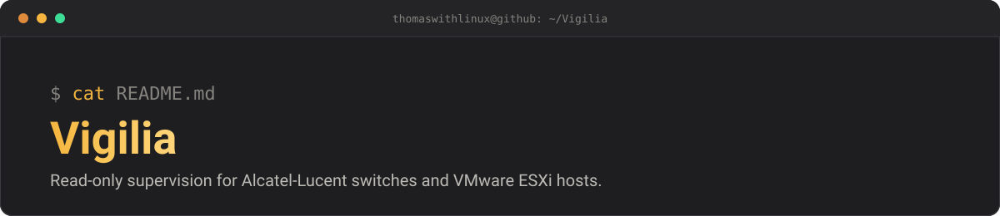
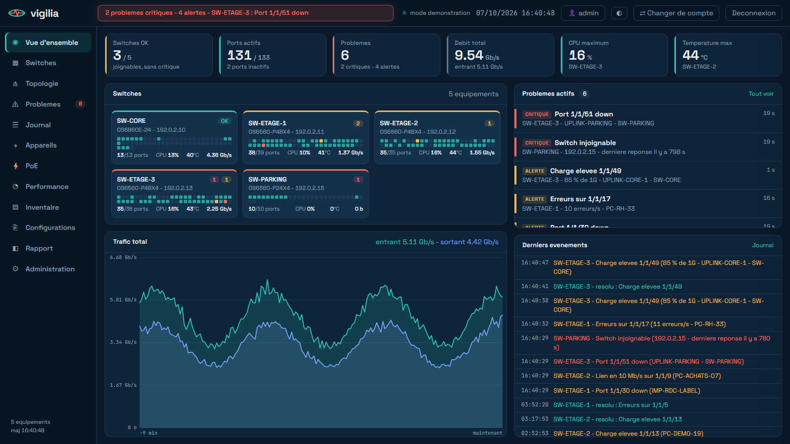

<p align="center">
  
</p>

# Vigilia — *always on watch*


**Read-only** supervision of the infrastructure: **Alcatel-Lucent Enterprise
OmniSwitch (AOS 8)** switches and, since v2, **VMware ESXi** hosts (virtual
machines, storage). One single interface, explained alerts, history and
configuration backups. Vigilia **changes nothing** on the supervised equipment.



> All screenshots come from the **demo mode** (fictional network, `192.0.2.x`
> addresses reserved for documentation). No real data is present in this
> repository.

## Table of contents

- [Versions](#versions)
- [Quick start](#quick-start)
- [Upgrading from v1 to v2](#upgrading-from-v1-to-v2)
- [Project structure](#project-structure)
- [Documentation](#documentation)
- [License](#license)
- [Author](#author)

## Versions

| Version | Folder | Content | Status |
|---|---|---|---|
| **v2** | [`v2/`](v2/) | Switches **+ VMware ESXi servers** (hosts, VMs, datastores), hardened security, 112 tests | **Current version** |
| v1 | [`v1/`](v1/) | Switches only, with built-in SSH terminal | Kept for reference |

Each folder is self-contained (code, documentation, tests, deployment).

## Quick start

```bash
cd v2
pip install -r requirements.txt
python server.py          # demo: http://127.0.0.1:8090/
```

## Upgrading from v1 to v2

The data (`data/`: database, accounts, certificates, backups) is compatible: v2
adds files, it does not change the existing format. Replace the code in
`/opt/vigilia` with the one from `v2/`, add `python3-requests`, then restart the
service. For ESXi servers, see *Supervising VMware ESXi hosts* in
[`v2/docs/INSTALLATION.md`](v2/docs/INSTALLATION.md).

> **Warning:** v2 does **not** include the built-in SSH terminal of v1 (see the
> changelog).

## Project structure

```
vigilia/
├── docs/
│   └── banner.svg       # README banner
├── v2/                  # current version (code, docs, tests, deploy)
├── v1/                  # previous version, kept for reference
├── .github/workflows/   # CI: automated tests
├── CHANGELOG.md         # history of the changes
├── LICENSE              # MIT license
└── README.md            # this file
```

## Documentation

- [`v2/README.md`](v2/README.md) — full presentation
- [`v2/docs/INSTALLATION.md`](v2/docs/INSTALLATION.md) — production setup
- [`v2/SECURITY.md`](v2/SECURITY.md) — security model
- [`CHANGELOG.md`](CHANGELOG.md) — history of the changes

> The detailed documentation inside `v1/` and `v2/` is written in French.

## License

Released under the **MIT** license — see the [LICENSE](LICENSE) file.

## Author

**Thomas Letard** — [@thomaswithlinux](https://github.com/thomaswithlinux) ·
[Portfolio](https://thomaswithlinux.github.io/)
